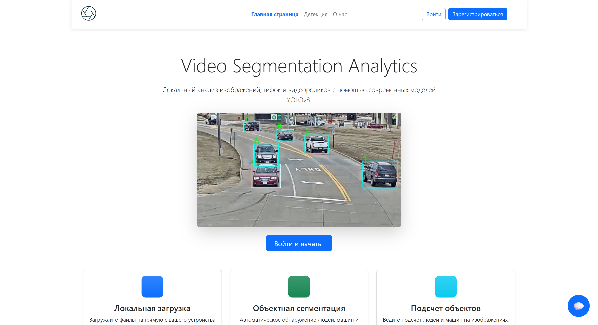
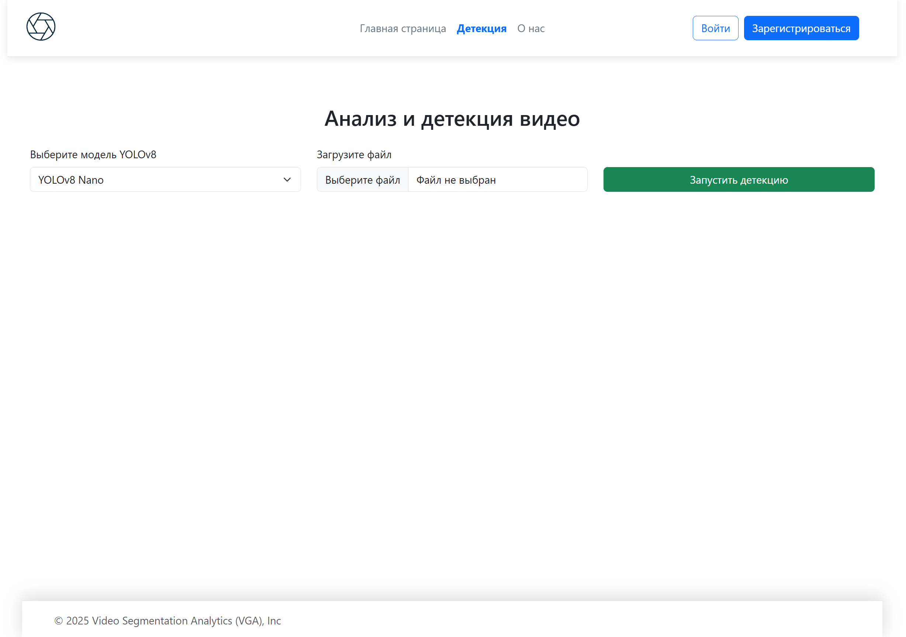

---

# Video Segmentation Analytics (VGA)

**Video Segmentation Analytics (VGA)** — это веб-приложение для детекции и аналитики объектов на видео с использованием нейронных сетей **YOLOv8**.

---

## 🚀 Возможности

- Загрузка видео для анализа
- Детекция объектов на видео с помощью модели YOLO
- Отображение результатов в браузере
- Аутентификация пользователей (регистрация/вход/выход)
- Удобный адаптивный интерфейс на **Bootstrap 5.3**
- Сообщения об ошибках и уведомления для пользователей

---

## 🛠️ Стек технологий

- Backend: **Python**, **Flask**
- Frontend: **HTML5**, **CSS3**, **Bootstrap 5.3**
- Нейронные сети: **YOLOv8** (Ultralytics)
- Хранилище файлов: **Файловая система**
- Аутентификация: **Flask-Login**
- Прочее: **Flask-WTF**, **WTForms**

---

## 📦 Установка проекта

1. Клонировать репозиторий:

```bash
git clone https://github.com/FunSkrip/vga.git
cd vga
```

2. Создать виртуальное окружение:

```bash
python -m venv venv
source venv/bin/activate  # Linux / macOS
venv\Scripts\activate     # Windows
```

3. Установить зависимости:

```bash
pip install -r requirements.txt
```

4. Скачать веса модели YOLO:

- Для YOLOv8:

```python
from ultralytics import YOLO
model = YOLO('yolov8n.pt')  # или yolov8s.pt / yolov8m.pt / yolov8l.pt
```

5. Запустить приложение:

```bash
flask run
```

---

## 📂 Структура проекта

```plaintext
vga/
├── app/
│   ├── static/
│   │   ├── css/
│   │   ├── img/
│   │   └── js/
│   ├── templates/
│   ├── routes/
│   ├── models/
│   ├── forms/
│   ├── detector.py
│   └── extensions.py
├── requirements.txt
├── config.py
├── run.py
└── README.md
```

---

## ✨ Скриншоты

| Главная страница | Страница детекции |
|:----------------:|:-----------------:|
|  |  |

---

## 🔒 Авторизация

- Зарегистрируйтесь для доступа к функции детекции.
- Только авторизованные пользователи могут загружать видео и просматривать результаты.

---


## 🔐 Безопасность и конфигурация

Скопируйте `.env.example` в `.env` и задайте значения:

```bash
APP_ENV=development
SECRET_KEY=<случайная строка не короче 32 байт>
GEMINI_API_KEY=<ключ Gemini, необязательно>
```

- В `APP_ENV=production` приложение не запустится без `SECRET_KEY`, с коротким ключом или с `SESSION_COOKIE_SECURE=0`.
- Сессия и CSRF-токен действуют 30 минут неактивности; параметры меняются через `SESSION_LIFETIME_MINUTES` и `CSRF_TIME_LIMIT_MINUTES`.
- Cookie сессии: `HttpOnly`, `SameSite=Lax`, в production — `Secure`.
- Выход из системы выполняется только через POST с CSRF-токеном.
- В production Flask слушает только `127.0.0.1`, TLS 1.3 и HSTS завершает reverse proxy. Шаблоны nginx и systemd — в `deploy/`.
- Для production используйте `wsgi.py` и настоящий WSGI-сервер, а не `python run.py`.

### Модели YOLO

- Эталонные SHA-256 и официальные URL лежат в `app/model_hashes.json`.
- Файл весов проверяется до передачи в Ultralytics/PyTorch; непроверенная модель не загружается.
- Список доступных моделей хранится в `app/instance/models_registry.json` и не меняет схему SQLite.
- Проверить локальные веса:

```bash
python tools/model_manifest.py --check
python tools/model_manifest.py --hash models/yolov8n.pt
```

Если файла модели нет, она не появится у пользователя. Автоматическая загрузка весов из интернета отключена.

---

## 🤝 Контакты

Если есть вопросы или предложения:
- 📧 Почта: flyiq440464@gmail.com

---
